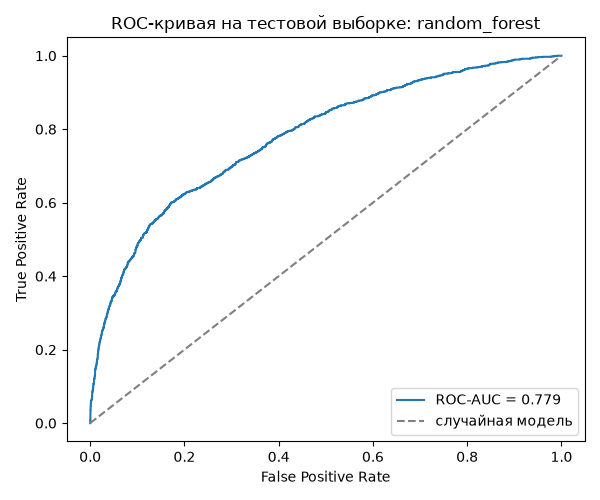
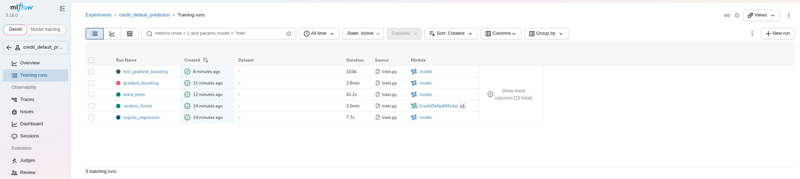

# PD-модель дефолта по кредитным картам

Пайплайн разработки, проверки, развёртывания и мониторинга модели, которая предсказывает вероятность дефолта клиента в следующем месяце. Данные — Default of Credit Card Clients Dataset (UCI, Kaggle), 30000 клиентов банка на Тайване.

## Структура

```text
credit-scoring-model/
├── data/
│   ├── raw/                       # исходный CSV, версионируется DVC
│   ├── processed/                 # train.csv и test.csv, выход стадии prepare
│   └── expectations/              # набор правил Great Expectations в JSON
├── models/                        # обученная модель, выход стадии train
├── notebooks/
│   ├── EDA_Кочкин.ipynb           # разведочный анализ, обоснование очистки, признаков и правил валидации
│   └── Эксперименты_Кочкин.ipynb  # анализ запусков MLflow и проверка лучшей модели
├── reports/                       # ROC-кривая, скриншот MLflow, отчёт о дрифте
├── scripts/docker_run.sh          # сборка и запуск Docker-образа, тестовый запрос
├── src/
│   ├── data/                      # make_dataset.py (загрузка, очистка, разбиение), validation.py (Great Expectations)
│   ├── features/                  # build_features.py (агрегаты истории платежей, группы возраста)
│   ├── models/                    # pipeline.py, train.py (подбор гиперпараметров, MLflow), metrics.py, predict.py
│   ├── api/                       # app.py (FastAPI)
│   └── monitoring/                # drift.py (PSI)
├── tests/                         # тесты pytest
├── .github/workflows/ci-cd.yml
├── Dockerfile
├── dvc.yaml, dvc.lock, params.yaml
├── metrics.json                   # метрики лучшей модели, выход стадии train
└── requirements.txt, requirements-dev.txt, pyproject.toml, .flake8
```

## Установка

Используем версию Python >=3.12,<3.15 -- на последних версиях не ставится great_expectations.

```bash
python3.12 -m venv .venv
source .venv/bin/activate
pip install -r requirements.txt -r requirements-dev.txt
```

Исходный файл UCI_Credit_Card.csv с Kaggle лежит в публичном S3-бакете, DVC скачивает его по URL из data/raw/UCI_Credit_Card.csv.dvc:

```bash
dvc update data/raw/UCI_Credit_Card.csv.dvc
```

## Запуск пайплайна

```bash
dvc repro
dvc metrics show
```

- prepare: проверяет сырые данные набором правил Great Expectations (при нарушении стадия падает), очищает их и делит на train и test 80/20 со стратификацией.
- train: для пяти алгоритмов подбирает гиперпараметры через RandomizedSearchCV и порог классификации по F1, пишет каждый запуск в MLflow, сохраняет лучшую по ROC-AUC на кросс-валидации модель в models/credit_default_model.pkl и регистрирует её в MLflow как CreditDefaultModel.

Параметры разбиения и поиска лежат в params.yaml. На 8 ядрах стадия train идёт около 6 минут.

Просмотр экспериментов:

```bash
mlflow ui --backend-store-uri sqlite:///mlflow.db
```

## Тесты и проверки

```bash
flake8 src tests
black --check src tests
python -m src.data.validation data/raw/UCI_Credit_Card.csv
pytest
```

GitHub Actions (.github/workflows/ci-cd.yml) запускает flake8 и black при каждом push, валидацию и тесты — для pull request в main или вручную через Run workflow на вкладке Actions. Перед проверками CI скачивает исходный файл через dvc update.

## Docker и API

```bash
./scripts/docker_run.sh
```

Скрипт собирает образ credit-scoring-api с моделью из models/, запускает контейнер на порту 8000 и отправляет тестовый запрос. Перед этим нужно выполнить dvc repro. Для podman: DOCKER=podman ./scripts/docker_run.sh.

API принимает признаки клиента после очистки: EDUCATION от 1 до 4, MARRIAGE от 1 до 3, статусы PAY_* от -2 до 9. Новые признаки строит сам Pipeline модели.

```bash
curl -X POST http://127.0.0.1:8000/predict \
  -H "Content-Type: application/json" \
  -d '{
    "LIMIT_BAL": 50000, "SEX": 2, "EDUCATION": 2, "MARRIAGE": 1, "AGE": 30,
    "PAY_0": 2, "PAY_2": 2, "PAY_3": 0, "PAY_4": 0, "PAY_5": 0, "PAY_6": 0,
    "BILL_AMT1": 48000, "BILL_AMT2": 47000, "BILL_AMT3": 46000, "BILL_AMT4": 45000, "BILL_AMT5": 44000, "BILL_AMT6": 43000,
    "PAY_AMT1": 0, "PAY_AMT2": 1500, "PAY_AMT3": 1500, "PAY_AMT4": 1500, "PAY_AMT5": 1500, "PAY_AMT6": 1500
  }'
```

Ответ:

```json
{"default_prediction":1,"default_probability":0.8021588935775353}
```

default_prediction — класс при подобранном пороге, default_probability — вероятность дефолта. Документация API: http://127.0.0.1:8000/docs.

## Мониторинг дрифта

```bash
python -m src.monitoring.drift --api-url http://127.0.0.1:8000
python -m src.monitoring.drift --api-url http://127.0.0.1:8000 --shift
```

Скрипт берёт 1000 клиентов из тестовой выборки как новые данные, отправляет их в API и считает PSI относительно обучающей выборки: для вероятности дефолта и для LIMIT_BAL, AGE, PAY_0, BILL_AMT1, PAY_AMT1. Флаг --shift искусственно сдвигает данные (лимит ×0.6, просрочка PAY_0 +1, счёт ×1.3), чтобы показать срабатывание. Пороги: PSI меньше 0.1 — нет дрифта, 0.1–0.25 — умеренный, больше 0.25 — значительный. Отчёт сохраняется в reports/drift_report.json.

## Результаты

Данные и валидация (notebooks/EDA_Кочкин.ipynb):

- NaN нет, ID уникален, дефолт у 22.1% клиентов.
- Коды EDUCATION 0 (не описан) и 5, 6 (unknown) объединены с категорией 4, код MARRIAGE 0 — с категорией 3.
- Набор правил Great Expectations — 71 проверка: состав и типы столбцов, NaN, уникальность ID, диапазоны LIMIT_BAL, AGE, PAY_*, PAY_AMT*, допустимые коды категорий и целевой переменной.
- Новые признаки PAY_DELAY_MONTHS и PAY_MAX связаны с дефолтом сильнее исходного PAY_0 (корреляция Спирмена 0.388 и 0.321 против 0.292), группа возраста показывает U-образную зависимость риска от возраста.

Эксперименты (notebooks/Эксперименты_Кочкин.ipynb), 5 запусков в MLflow:

| модель | ROC-AUC CV | ROC-AUC test | precision | recall | F1 |
|---|---|---|---|---|---|
| random_forest | 0.7859 | 0.7795 | 0.5295 | 0.5539 | 0.5414 |
| hist_gradient_boosting | 0.7851 | 0.7795 | 0.5160 | 0.5599 | 0.5370 |
| gradient_boosting | 0.7842 | 0.7854 | 0.5306 | 0.5622 | 0.5459 |
| extra_trees | 0.7827 | 0.7752 | 0.5221 | 0.5433 | 0.5325 |
| logistic_regression | 0.7601 | 0.7471 | 0.4747 | 0.5592 | 0.5135 |

Модель выбирается по ROC-AUC на кросс-валидации, тестовая выборка в выборе не участвует. Лучшая модель — случайный лес. Ансамбли отличаются меньше чем на 0.004, логистическая регрессия отстаёт на 0.026.





Дрифт на 1000 клиентах из тестовой выборки:

| | без сдвига | с --shift |
|---|---|---|
| default_probability | 0.0063 | 0.8137 |
| LIMIT_BAL | 0.0080 | 0.8009 |
| AGE | 0.0121 | 0.0121 |
| PAY_0 | 0.0044 | 1.1553 |
| BILL_AMT1 | 0.0055 | 0.0461 |
| PAY_AMT1 | 0.0091 | 0.0091 |

Ограничение: лучшая модель обучена с class_weight=balanced, поэтому её вероятности завышены относительно реальной доли дефолтов (средняя вероятность на новых данных 0.420 при доле дефолтов 0.212). Для ранжирования клиентов и классификации это не мешает. Если PD нужна как калиброванная вероятность, модель нужно дополнительно калибровать.
