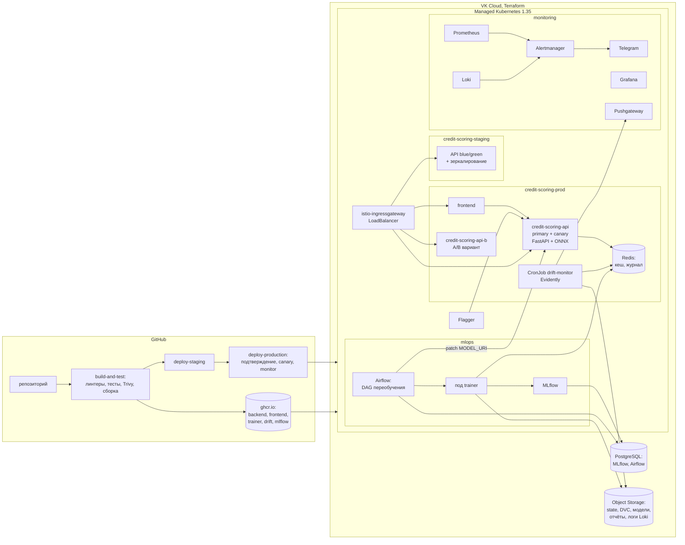

# Архитектура

## Инфраструктура (infrastructure/)

Terraform, провайдер vkcs, state в Object Storage с блокировкой (use_lockfile). Модули:

- network: сеть и подсеть узлов на SDN sprut, роутер во внешнюю сеть. Узлы без публичных адресов, наружу через NAT роутера.
- kubernetes: Managed Kubernetes v2 (1 мастер, Calico), группы узлов app (STD3-4-8, автомасштаб 2–6) и system (STD3-4-16, 1–2), GPU-группа за переменной gpu_enabled. Политики безопасности Gatekeeper: запрет hostPath и host namespace везде, кроме monitoring, запрет NodePort. Доступ к API Kubernetes ограничивается переменной api_allowed_cidrs.
- storage: managed PostgreSQL 16 в приватной сети за security group (порт 5432 только из подсети узлов и сети подов), базы mlflow и airflow, отдельный S3-аккаунт для сервисов кластера, приватные бакеты mlflow, models, loki, reports.
- monitoring: helm-релизы kube-prometheus-stack (Prometheus, Alertmanager → Telegram, Grafana, node-exporter, kube-state-metrics), Loki, Alloy, Pushgateway; правила алертов и дашборды.

Окружения environments/production и environments/staging собраны из одних модулей с разными размерами. Развёрнут production-кластер, staging работает в нём отдельным namespace: второй кластер удвоил бы стоимость.

## Платформа кластера (deployment/platform, deployment/mlops)

- Istio 1.30: ingress gateway с балансировщиком VK, sidecar в namespace приложения, метрики Envoy для Flagger.
- Flagger: canary в production, blue-green с зеркалированием в staging, автоматический откат по метрикам.
- MLflow: tracking и реестр моделей, метаданные в PostgreSQL, артефакты в S3.
- Airflow 3 с KubernetesExecutor, DAG из репозитория через git-sync.

## Приложение (deployment/kubernetes)

kustomize: base и overlays staging и production.

- credit-scoring-api: FastAPI + ONNX Runtime. Rolling update (maxSurge 1, maxUnavailable 0), HPA по CPU 60% (2–8 подов), PDB, распределение по узлам, readOnlyRootFilesystem, без root.
- credit-scoring-frontend: статическая страница на nginx, запросы к API через тот же адрес.
- Redis: кеш предсказаний (TTL 1 час) и журнал запросов (stream predictions) для мониторинга дрифта и переобучения.
- ConfigMap — настройки, Secret — ключи S3 (создаёт CI).
- NetworkPolicy: входящий трафик запрещён по умолчанию, разрешён от ingress gateway, Prometheus, фронтенда и loadtester Flagger.
- Ingress (staging, ingressClassName istio) и VirtualService (production, генерирует Flagger).

## Модель и её версии

- Обучение: MLP на PyTorch, предобработка внутри графа (src/models/nn.py), экспорт в ONNX и проверка совпадения ответов (src/models/onnx_conversion.py), квантизация и pruning (src/models/optimize.py). Пайплайн в DVC, данные и модели в S3.
- Модель по умолчанию встроена в образ backend из DVC. Новые версии лежат в бакете mifirobo-prod-models/<версия>/ и подключаются переменной MODEL_URI без пересборки образа.
- production.json в бакете указывает текущую production-версию. Его обновляет DAG переобучения после успешного canary.

## Потоки данных

1. Запрос клиента → istio-ingressgateway → API → ONNX → ответ. Признаки и вероятность пишутся в Redis stream, метрики — в Prometheus, JSON-лог — в Loki через Alloy.
2. Факт дефолта приходит позже через POST /feedback и связывается с запросом по request_id.
3. Раз в час drift-monitor сравнивает журнал с обучающей выборкой (Evidently): дрифт признаков, вероятностей, ROC-AUC на размеченных ответах. Метрики идут в Pushgateway, отчёт — в S3.
4. DAG credit_scoring_drift_trigger читает отчёт и при дрифте запускает DAG credit_scoring_retraining. Этот DAG запускается и по расписанию раз в неделю.
5. Переобучение в поде trainer: исходные данные плюс размеченные ответы, сравнение с production на одних данных, выгрузка в S3 и MLflow. Затем MODEL_URI у Deployment меняется, и Flagger ведёт canary до продвижения или отката.
